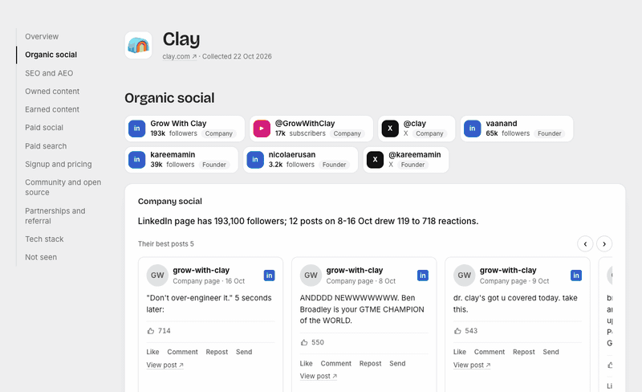

# Growth Sneak

See how any company grows, with the proof.

```
/sneak clay.com
```



*A sample report on clay.com. Every number and quote links to its source.*

Growth Sneak is a Claude Code plugin for founders and growth leads. Give it a company's URL. It collects public
evidence of how that company gets customers across 18 growth activities, and opens one local HTML report:

- **Overview**: the company, its domain and when the data was collected
- **Site traffic**: six months of estimated monthly visits (Similarweb)
- **Nine sections**: organic social, SEO and AEO, owned content, earned content, paid social, paid search, signup
  and pricing, community and open source, partnerships and referral. Each activity shows what we saw, one cited
  sentence, the real posts, ads, tables or page screenshots behind it, a few key facts, and links to its sources
- **Tech stack** and **what we could not see**

Every claim links to its source. Anything we could not check is marked "Not covered", never guessed and never
shown as 0. The sections and activities are the same for every company (see `references/taxonomy.md`), so two
reports can be compared side by side.

## Install

Growth Sneak is a **Claude Code** plugin. It works in the Claude Code terminal and in the **Code tab** of the Claude
desktop app. It needs [Claude Code](https://code.claude.com/docs/en/overview) and Node.js 20 or newer
(`node --version`) installed, because the plugin runs small Node scripts on your computer.

### Easiest: paste this to Claude

Open Claude Code (terminal or the desktop Code tab) and paste:

````text
Install the Growth Sneak plugin for me. It is a Claude Code plugin published on GitHub at zmstr2/growth-sneak.

Please:
1. Run `node --version` and check it is 20 or newer. If Node is missing or older, stop and tell me how to install it for my system. Do not install it without asking me.
2. Run `claude plugin marketplace add zmstr2/growth-sneak` and show me the output.
3. Run `claude plugin install growth-sneak@growth-sneak` and show me the output.
4. Run `claude plugin list` and confirm `growth-sneak@growth-sneak` shows as enabled.
5. If a command fails, show me the exact error and suggest the fix. Do not try workarounds that change my settings or run anything from a source other than zmstr2/growth-sneak.

When it is installed, tell me to restart Claude Code (or type /reload-plugins, which only I can run), then run /sneak followed by a company's website, for example /sneak clay.com. Tell me Claude Code will ask me for a Firecrawl and an Exa API key (in a masked field) and that I can get them at https://www.firecrawl.dev/app/api-keys and https://dashboard.exa.ai/api-keys. Do not run /sneak yourself, and do not create accounts or enter API keys for me.
````

Claude will ask permission to run each command. Approve them, then restart.

### Claude Code in the terminal

```
/plugin marketplace add zmstr2/growth-sneak
/plugin install growth-sneak@growth-sneak
```

`/plugin install` opens the plugin's details so you can pick where to install it (for you, for a project, or for this
folder only). Choose "Install for you" to use it in every project. Or run the same thing from your shell without a
session: `claude plugin marketplace add zmstr2/growth-sneak`, then `claude plugin install growth-sneak@growth-sneak`.
On Claude Code 2.1.292 or newer, one command does both: `claude plugin install growth-sneak --marketplace zmstr2/growth-sneak`.

### Claude desktop app (Code tab)

The desktop app's Code tab and the terminal read the same plugin settings, so a plugin you add in one is available in
the other.

1. Add the marketplace once: run `claude plugin marketplace add zmstr2/growth-sneak` in any terminal, or in the app
   open **Customize > Plugins > Add > Add marketplace** and enter `zmstr2/growth-sneak`.
2. In a local Code-tab session, click **+** next to the prompt box and choose **Add plugins** (or **Plugins**, then
   **Browse plugins**). Select **Growth Sneak** and choose a scope.

Plugins don't load in cloud sessions or at claude.ai/code in the browser, so use a local session. Growth Sneak is
built for Claude Code; it isn't set up for claude.ai chat or Cowork, which don't run its scripts or save the report
on your computer.

### After installing

Restart Claude Code (or type `/reload-plugins`), type `/` and look for `/growth-sneak:sneak`, then run:

```
/sneak clay.com
```

The first run asks for two API keys (below). Update later with `claude plugin update growth-sneak@growth-sneak`.
To work on the plugin itself, clone the repo and start Claude Code with `claude --plugin-dir /path/to/growth-sneak`.

## First run: two API keys

Growth Sneak reads pages and searches the web through two services. Both have free credits to start:

| Service | What it does here | Get a key |
|---|---|---|
| **Firecrawl** | Google and Meta ads, page screenshots, pricing, the rendered tech stack, X posts, data providers | https://www.firecrawl.dev/app/api-keys (starts with `fc-`) |
| **Exa** | founders' posts, press, reviews, events, community | https://dashboard.exa.ai/api-keys |

Claude Code asks for both keys when you enable the plugin: paste each into its masked field and you are done. If
you skipped the prompt, type `/plugin`, open **Installed**, choose **growth-sneak**, then **Configure options**.
Keys are stored in Claude Code's secure storage, never in the plugin, a report or the chat.

## Other data sources (optional)

| Source | Setup | What it adds |
|---|---|---|
| Free scripts | nothing | sitemap, robots.txt, llms.txt, GitHub, Discord, Hacker News, ad-library links |
| Apify | connect the Apify MCP server | fuller LinkedIn and X post history (opt-in; respect each platform's terms) |

**Firecrawl Alexandria** is a catalogue of data providers reached through your Firecrawl connection. Growth Sneak
uses Google's Ads Transparency data, Similarweb (traffic) and Oriane (Instagram and TikTok, where indexed). It always looks up a provider's price before calling it,
reports what it spent, and never accepts a provider's terms for you.

**Paid social.** Meta ads come from Meta's public Ad Library, read through Firecrawl (5 credits). LinkedIn's and
TikTok's libraries block automated reads, so the report links to them and marks them "Not covered".

**Cost.** In real runs, a report without traffic cost 72 to 81 Firecrawl credits, plus 5 for Meta ads. Six months of
Similarweb traffic adds 660 (about 750 in total), so Growth Sneak asks before collecting it (or say "with traffic").
The report's footer shows what the run spent. A run takes a few minutes.

## How it works

```
/sneak  ->  free scripts (sitemap, site checks, social links)
        ->  4 collector agents in parallel (paid, owned, social, company)  -> fragments/
        ->  scripts/merge.mjs   -> evidence.json  (every fact, with its source)
        ->  analyst agent       -> analysis.json  (one cited sentence per activity, and the gaps)
        ->  scripts/render.mjs  -> report.html
```

Collectors only record facts with links. Nothing is scored: code works out, per activity, whether we saw it,
checked and found none, or could not look (`scripts/coverage.mjs`). The analyst writes the only per-company prose. The renderer enforces the honesty rules in code: an uncited sentence is dropped, an unknown evidence id
stops the build, "not found" needs a recorded check, and posts show their real numbers or "engagement not
visible".

Reports are saved in `reports/<domain>/` in your current folder.

## Privacy

Growth Sneak reads only public pages and public data. It never signs in, creates accounts or fills in forms. Page
content goes to the data providers you connect (Firecrawl, Exa). The report is one local HTML file. Screenshots are saved inside it; fonts, the company's favicon, and
ad and post preview images load from their own hosts (Google Fonts, Google's ad servers, Meta and other
platforms' image servers) when you open it.

## Development

```bash
npm test                                          # no dependencies, Node 20+
node scripts/render.mjs tests/fixtures/exa.ai     # render the sample report
```

`DESIGN.md` describes the report's design. `docs/design-log.md` is the working log from building it.

MIT licensed.
