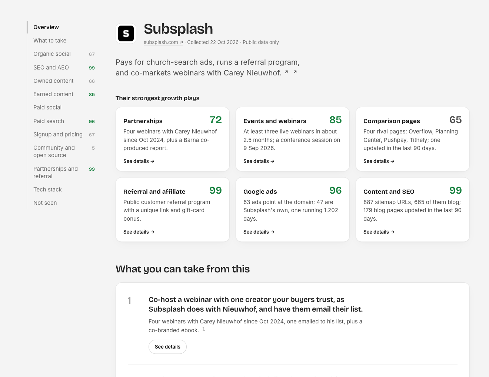
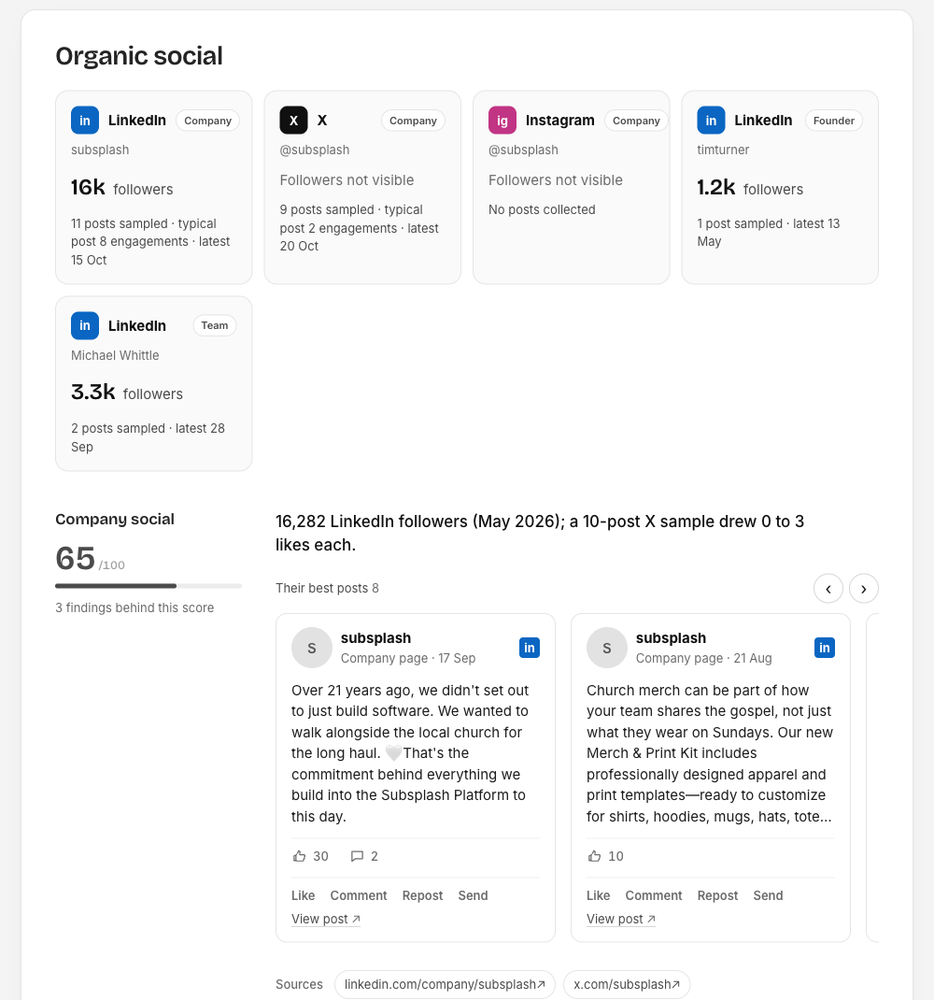

# Growth Sneak

See how any company grows, with the proof.

```
/sneak subsplash.com
```





*A report on subsplash.com. Every number and quote links to its source.*

Growth Sneak is a Claude Code plugin for founders and growth leads. Give it a company's URL. It collects public
evidence of how that company gets customers, scores 17 growth activities from 0 to 100, and opens one local HTML
report:

- **Overview**: the company, one line on how it grows, and cards for its strongest growth plays
- **What you can take from this**: two to four moves you could borrow, each starting from something we saw
- **Site traffic**: six months of estimated monthly visits (Similarweb)
- **Nine sections**: organic social, SEO and AEO, owned content, earned content, paid social, paid search, signup
  and pricing, community and open source, partnerships and referral. Each activity shows its score, one cited
  sentence, the real posts, ads or page screenshots behind it, a few key facts, and links to every source
- **Tech stack** and **what we could not see**

Every claim links to its source. Anything we could not check is marked "Not covered", never guessed and never
shown as 0. The sections and activities are the same for every company (see `references/taxonomy.md`), so two
reports can be compared side by side.

## Install

From a clone of this repo, in Claude Code:

```
/plugin marketplace add /path/to/growth-sneak
/plugin install growth-sneak@growth-sneak
```

or start Claude Code with `claude --plugin-dir /path/to/growth-sneak`. The plugin brings its own Firecrawl and Exa
connections (`.mcp.json`); sign in to Firecrawl when asked, or run `/mcp` and choose it.

## Data sources (all optional)

| Source | Setup | What it adds |
|---|---|---|
| None | nothing | sitemap, robots.txt, llms.txt, GitHub, Discord, Hacker News, ad-library links |
| **Firecrawl** | included; sign in when asked (OAuth) | Google ads, page screenshots, pricing, the rendered tech stack, X posts, and Alexandria providers (below) |
| **Exa** | included; works without a key | founders, LinkedIn posts, press, reviews, events, community |
| **TypeSafe** | `export TYPESAFE_API_KEY=...` | scores from the Jev model (without it, the analyst agent scores the same rubric) |
| Apify | connect the Apify MCP server | fuller LinkedIn and X post history (opt-in; respect each platform's terms) |

**Firecrawl Alexandria** is a catalogue of data providers reached through your Firecrawl connection. Growth Sneak
uses Google's Ads Transparency data, Similarweb (traffic), Upspring (Meta ads, mostly consumer brands), Oriane
(Instagram and TikTok, where indexed) and job boards. It always looks up a provider's price before calling it,
reports what it spent, and never accepts a provider's terms for you.

**Cost.** In real runs, a report without traffic cost 72 to 81 Firecrawl credits. Six months of Similarweb traffic
adds 660 (about 750 in total), so Growth Sneak asks before collecting it (or say "with traffic"). The Upspring
Meta lookup adds 150 when the brand is in its data and nothing when it is not. The report's footer shows what the
run spent. A run takes a few minutes.

## How it works

```
/sneak  ->  free scripts (sitemap, site checks, social links)
        ->  4 collector agents in parallel (paid, owned, social, company)  -> fragments/
        ->  scripts/merge.mjs   -> evidence.json  (every fact, with its source)
        ->  scripts/score.mjs   -> scores.json    (17 activities, 0 to 100)
        ->  analyst agent       -> analysis.json  (headline, one sentence per activity, plays, takeaways)
        ->  scripts/render.mjs  -> report.html
```

Collectors only record facts with links. The scores come from a fixed four-level rubric per activity
(`scripts/rubric.mjs`), scored by Jev or, without a key, by the analyst. The analyst writes the only per-company
prose. The renderer enforces the honesty rules in code: an uncited sentence is dropped, an unknown evidence id
stops the build, "not found" needs a recorded check, and posts show their real numbers or "engagement not
visible".

Reports are saved in `reports/<domain>/` in your current folder.

## Privacy

Growth Sneak reads only public pages and public data. It never signs in, creates accounts or fills in forms. Page
content goes to the data providers you connect; with a TypeSafe key, the collected evidence lines go to TypeSafe
for scoring. The report is one local HTML file. Screenshots are saved inside it; fonts, the company's favicon, and
ad and post preview images load from their own hosts (Google Fonts, Google's ad servers, Meta and other
platforms' image servers) when you open it.

## Development

```bash
npm test                                          # no dependencies, Node 20+
node scripts/render.mjs tests/fixtures/exa.ai     # render the sample report
```

`DESIGN.md` describes the report's design. `docs/design-log.md` is the working log from building it.

MIT licensed.
